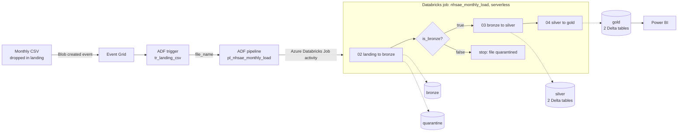
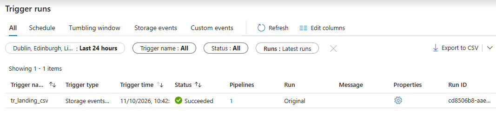
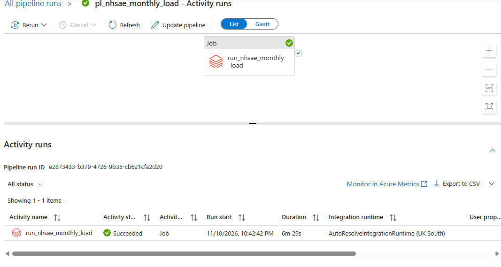
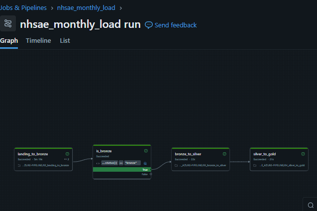
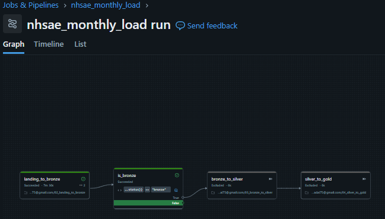
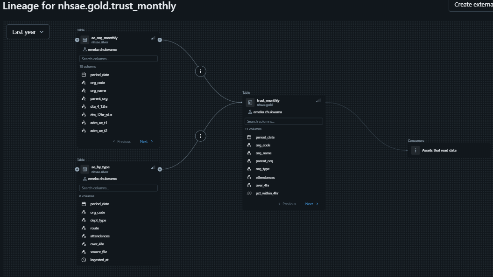
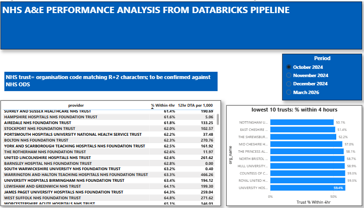

# NHS A&E Monthly Pipeline on Azure

An event-driven Azure data pipeline that ingests NHS England's monthly A&E attendances and emergency admissions data, validates it, models it into a medallion lakehouse, and produces reporting tables. Each published month matches NHS England's figures exactly or within later revisions to the source data.

When a monthly CSV lands in storage, the whole pipeline runs by itself. Nobody types a file name or clicks Run.

> Built by Emeka Chukwuma, a pharmacist with over 20 years' experience moving into data engineering, alongside an MSc in Health Informatics at Swansea University.

---

## Architecture

| Layer | Contents |
|---|---|
| **Landing** | Files as they arrive. Emptied after each run. |
| **Bronze** | Every accepted file kept unchanged, stored as `YYYY/MM/<UTC timestamp>_<file>.csv`. Revised files sit alongside the originals and never overwrite them. |
| **Quarantine** | Rejected files, each with a `reason.json` explaining why. |
| **Silver** | `ae_by_type`: one row per organisation, month, department type and route (booked/unbooked). `ae_org_monthly`: one row per organisation and month, holding organisation-level measures. |
| **Gold** | `national_by_type`: national totals by department type and route. `trust_monthly`: provider-level performance. |
| **Ops** | `run_log`: one row per stage per run. `dq_rejects`: invalid rows with their reason and original values. |

## Tech stack

Azure Data Lake Storage Gen2 · Azure Data Factory · Azure Event Grid · Azure Databricks (serverless) · Unity Catalog · Delta Lake · PySpark / Spark SQL · GitHub

---

## How it works

### 1. Landing to bronze (`02_landing_to_bronze`)
Checks run in order, cheapest first, and each one runs only if the earlier ones passed:

1. **The file exists** in landing. If it doesn't (for example, it has already been processed), the run logs `not_found` instead of crashing.
2. **The file name** matches `ae_YYYY_MM.csv`. Badly named files are quarantined, not renamed, because renaming would mean guessing the month.
3. **The columns** exactly match the schema contract, and the file isn't empty.
4. **The period inside the file** matches the period in the file name. This catches a file named March that actually contains April.

Passing files move to bronze. Failing files move to quarantine with a reason.

### 2. Bronze to silver (`03_bronze_to_silver`)
- Separates the national **TOTAL** row from the organisation rows before parsing.
- Renames columns using the shared schema contract (`00_config`), and converts numbers with `try_cast`, keeping the original value alongside for evidence.
- Applies row-level quality rules: missing org code, failed type conversion, negative values, over-4-hour count larger than attendances, and duplicate organisation-month.
- Writes invalid rows to `ops.dq_rejects`. **If more than 5% of rows are invalid, the whole file is rejected.**
- **Reconciles** the sum of organisation rows to the TOTAL row, column by column. Any mismatch stops the run.
- Writes the month with Delta `replaceWhere`, so **re-running a month replaces it instead of duplicating it**.
- Stores lineage in every row: `source_file` (the exact bronze copy) and `ingested_at`.

### 3. Silver to gold (`04_silver_to_gold`)
Rebuilds both gold tables from all of silver on every run. At about 200 rows a month this takes seconds and means gold can never drift out of step with silver.

### 4. Orchestration
- **Databricks job** `nhsae_monthly_load` chains the notebooks. Task values pass `status` and `bronze_path` between tasks, and an if/else task skips silver and gold when a file is quarantined. The job definition is in [`nhsae_monthly_load.yml`](nhsae_monthly_load.yml).
- **ADF** listens for new `.csv` files in landing and starts the job, passing the file name through: trigger → pipeline parameter → job parameter → notebook widget.

**A file dropped in landing fires the trigger by itself:**

**The ADF pipeline runs the Databricks job:**

**A valid A&E file runs every stage (`is_bronze` takes the True branch):**

**A wrong file is quarantined, and silver and gold are skipped (`is_bronze` takes the False branch):**

### 5. Lineage
Unity Catalog records table-level lineage automatically from the job runs, with no extra code. Any gold figure can be traced back to its silver sources:

### 6. Power BI report
[`powerbi/nhsae_azure_report.pbix`](powerbi/nhsae_azure_report.pbix) reads the two gold tables through a Databricks serverless SQL warehouse in **Import mode**, so the report works without a running workspace.

- **National overview:** attendances and % within 4 hours for the selected month, the four-month trend, and performance by department type and booked/unbooked route. All percentages are DAX measures over summed counts, never averages of percentages.
- **Trust comparison:** NHS trusts ranked by % within 4 hours, with 12-hour decision-to-admit waits per 1,000 emergency admissions, and the 10 lowest-performing trusts.

The month trend uses a categorical axis, so the gap between December 2024 and March 2026 isn't drawn as an invented trend.

Power BI's Microsoft Entra ID sign-in doesn't accept personal Microsoft accounts, so the one-off import used a personal access token limited to the **BI Tools (SQL)** scope with a **1-day** lifetime, revoked immediately after the load.

---

## Data design decisions

- **Store counts, derive percentages.** Percentages are always calculated from summed counts, never averaged. Averaging would give a 700-attendance unit the same weight as a 1.4-million-attendance department.
- **Long (unpivoted) by-type table** with `dept_type` and `route` columns, so new breakdowns don't need new columns.
- **Organisation-level measures in a separate table**, so they aren't repeated across department-type rows and double-counted.
- **12-hour decision-to-admit waits per 1,000 emergency admissions**, so organisations of different sizes can be compared.
- **Booked appointments are included** in headline 4-hour performance. Confirmed by matching NHS England's published figure.

## Security

- **No keys, passwords or tokens anywhere.** Databricks reaches storage through an access connector's managed identity, registered in Unity Catalog as a storage credential with an external location per container. ADF reaches Databricks through its own managed identity.
- **Least privilege.** ADF's identity is a Databricks service principal with workspace access only, and **Can Manage Run** on this one job. It can start and cancel runs but cannot edit the job or reach anything else. The common shortcut of making ADF a workspace admin was deliberately avoided.
- The GitHub app is limited to this repository only.

---

## Validation against published figures

| Month | Attendances (pipeline) | Within 4 hrs (pipeline) | NHS England first release |
|---|---|---|---|
| Oct 2024 | 2,360,536 | 73.1% | 73.0% (2,356,189 attendances) |
| Nov 2024 | 2,314,998 | 72.2% | 72.1% |
| Dec 2024 | 2,345,934 | 71.1% | 71.1% (2,345,934 attendances) |
| Mar 2026 | 2,432,272 | 77.1% | 77.1% |

December 2024 and March 2026 match exactly. October and November sit 0.1 point higher because the files downloaded later contain revised data. NHS England's 2024-25 statistics page lists a revised November 2024 file. In March 2026 the within-4-hour count differs by 118, all of it in Type 1 departments, with every published percentage and decision-to-admit count matching.

The October 2024 and March 2026 files passed the same schema contract, so the source layout was stable across 18 months.

## Testing

Every branch was tested by changing only the input, never the code:

| Test | Input | Result |
|---|---|---|
| Happy path | `ae_2026_03.csv` | Bronze → silver → gold |
| Already processed | file no longer in landing | `not_found`, logged, no crash |
| Wrong dataset | `rtt_apr2026_clean.csv` | Quarantined (`bad_file_name`); silver and gold skipped |
| Re-run a month | same month twice | Row counts unchanged (idempotent) |
| Fully automated | `ae_2024_12.csv` uploaded to landing | Trigger fired; job succeeded with no manual steps |

One bug found during testing: a run given a folder path instead of a file path loaded correct numbers but left `source_file` empty. It was caught by checking the run's exit message, fixed by re-running (which replaced the month cleanly), and guarded with a `.csv` path check.

---

## Cost

Built on a personal Azure subscription with a £45 budget and an 80% forecast alert. The alert fired during development and was traced to two causes:
- **Serverless compute** used during development. The job uses standard serverless (performance optimised off): cheaper, with a few minutes of start-up, which is fine for a monthly batch.
- **A NAT gateway** created automatically by the Hybrid Databricks workspace and billed hourly whether or not anything runs.

Because the code and job definition are in Git, and the data and Unity Catalog objects sit outside the workspace, the workspace can be deleted between work sessions and rebuilt when needed.

## Repository contents

| File | Purpose |
|---|---|
| `00_config` | Schema contract (column mapping), volume paths, file name pattern |
| `01_explore_landing` | Exploration and prototyping notebook |
| `02_landing_to_bronze` | File checks, bronze or quarantine, run log |
| `03_bronze_to_silver` | Cleaning, data quality, reconciliation, silver writes |
| `04_silver_to_gold` | Gold rebuild and headline check |
| `nhsae_monthly_load.yml` | Databricks job definition |
| `powerbi/nhsae_azure_report.pbix` | Power BI report on the gold tables |

## Rebuilding

1. Create a Databricks workspace and attach it to the existing Unity Catalog metastore.
2. Add this repo as a Git folder.
3. Recreate the job from `nhsae_monthly_load.yml`.
4. Add ADF's managed identity as a service principal with Can Manage Run on the job, and point the ADF linked service at the new workspace.

## Next steps

- Confirm the NHS trust flag (currently a code-pattern rule) against the NHS ODS reference data
- Failure alerts from ADF

## Data source

[NHS England – A&E Attendances and Emergency Admissions](https://www.england.nhs.uk/statistics/statistical-work-areas/ae-waiting-times-and-activity/). Published under the Open Government Licence.
